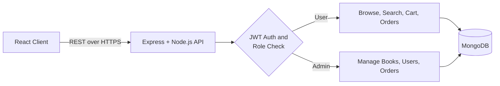
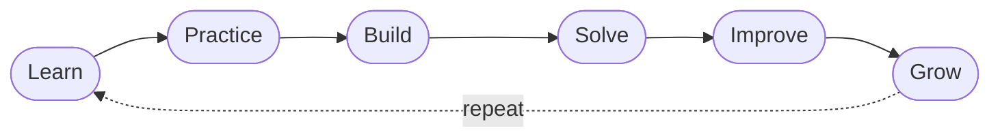

<!-- ============================== HEADER ============================== -->
<div align="center">


<a href="https://github.com/bhanusri-manukonda">
  
</a>

<br/>

<a href="https://bhanusri-portfolio.netlify.app/"></a>
<a href="http://www.linkedin.com/in/bhanusri-manukonda-2a30233b3"></a>
<a href="mailto:manukondabhanusri6@gmail.com"></a>

<br/><br/>


</div>

---

## 🖥️ `who am i`

```bash
$ who am i
bhanusri-manukonda

$ cat about.txt
B.Tech CSE student at Aditya College of Engineering and Technology (2023 - 2027),
building full stack apps with MERN and Django, and sharpening fundamentals
through Java, Data Structures & Algorithms, and SQL.

$ echo $GOAL
Software / Full Stack Developer building reliable software that solves real problems

$ git status
On branch main
Currently building: projects, problem-solving habits, and production-ready skills
```

---

## 💼 Experience

<table>
  <tr>
    <td width="170"><b>May 2025 – Jul 2025</b></td>
    <td>
      <b>Full Stack Web Development Intern</b> — <i>APSSDC</i><br/><br/>
      • Built a <b>Django e-commerce application</b> with Python, Django, HTML, CSS, Bootstrap, and JavaScript.<br/>
      • Implemented <b>authentication, product management, search & filtering, shopping cart, and order management</b> with full database integration.
    </td>
  </tr>
</table>

---

## 🧰 Tech Arsenal

<div align="center">

| Layer | Tools |
|:---|:---|
| **Languages** |  |
| **Frontend** |  |
| **Backend** |  |
| **Databases** |  |
| **Tools** |  |

</div>

<p align="center">
  <code>DSA</code> · <code>OOP</code> · <code>DBMS</code> · <code>Operating Systems</code> · <code>Computer Networks</code> · <code>REST APIs</code>
</p>

---

## 🚀 Featured Projects

<table>
<tr>
<td width="50%" valign="top">

### 📚 Books World
**MERN Bookstore Application**

Full-stack bookstore with secure auth, a rich catalog, and a complete admin dashboard.

- 🔑 **JWT auth**, password hashing & **role-based access**
- 🔍 Search & filter by title, author, category (**50+ books**)
- 🛒 Cart, orders & **discount pricing**
- 🛠️ Admin dashboard for books, users & orders
- ✅ Form validation & error handling

`MongoDB` `Express` `React` `Node.js` `JWT`

[**🔗 View Repository**](https://github.com/bhanusri-manukonda/books-world-online-shopping-)

</td>
<td width="50%" valign="top">

### 📖 Book Store Management System
**Django Inventory, Sales & Rental App**

Admin-only system with a modular **MVT architecture** and a relational MySQL schema.

- 📦 Inventory, sales & rental management
- 🧮 Automated **rental charge, fine & refund** calculations
- 🧾 Printable transaction receipts
- 🗄️ Relational schema design

`Python` `Django` `MySQL` `Bootstrap 5`

<!-- Replace with your repository link -->
[**🔗 View Repository**](YOUR_BOOKSTORE_MANAGEMENT_REPOSITORY_URL)

</td>
</tr>
<tr>
<td width="50%" valign="top">

### 🔍 NetTool
**Network Diagnostic Toolkit**

A Python CLI toolkit built on core **Computer Networks** concepts and socket programming.

- 📡 **Ping**, **port scan**, **DNS lookup**, **HTTP checks**, **traceroute**
- 🔌 Socket-based network operations
- 🛠️ Troubleshoot connectivity & service availability

`Python` `Sockets` `CLI`

<!-- Replace with your repository link -->
[**🔗 View Repository**](YOUR_NETTOOL_REPOSITORY_URL)

</td>
<td width="50%" valign="top">

### 🌐 Personal Portfolio
**Developer Portfolio Website**

A responsive site showcasing my skills, projects, and professional profile.

- 🎨 Clean, responsive layout
- 📂 Project showcase & skills overview

`HTML5` `CSS3` `JavaScript`

[**🌐 Live Site**](https://bhanusri-portfolio.netlify.app/)

</td>
</tr>
</table>

<details>
<summary><b>🧭 Peek inside Books World: request flow</b></summary>

<br/>



</details>

---

## 🎓 Education & Certifications

<table>
<tr>
<td width="60%" valign="top">

| Year | Qualification | Score |
|:---:|:---|:---:|
| **2023 – 2027** | B.Tech CSE, Aditya College of Engineering and Technology, Surampalem | **CGPA 7.7** |
| 2021 – 2023 | Intermediate (MPC), Vikas Junior College, Samisragudem | **88%** |
| 2020 – 2021 | Secondary, St Ann's English Medium School, Nidadavole | **96%** |

</td>
<td width="40%" valign="middle" align="center">


<br/>

<br/>


</td>
</tr>
</table>

---

## 🧭 Mission Log



| Status | Mission |
|:---:|:---|
| ✅ | Built full stack projects with **MERN** and **Django** |
| ✅ | Completed a Full Stack Web Development internship at **APSSDC** |
| ✅ | Earned Python and Full Stack certifications |
| 🔄 | Solving DSA problems, targeting **100+** |
| 🔄 | Mastering **Java & OOP**, plus **SQL** and database design |
| 🎯 | Deploy more real-world applications |
| 🎯 | Contribute to meaningful software projects |
| 🎯 | Start a career as a **Software / Full Stack Developer** |

---

## 📊 GitHub Analytics

<div align="center">


<br/>


<br/>


</div>

---

<div align="center">

### 💌 Let's build something great together

Reach me through the buttons at the top, or just drop a message at **manukondabhanusri6@gmail.com**.

> *"Keep learning, keep building, and keep improving."*


</div>
